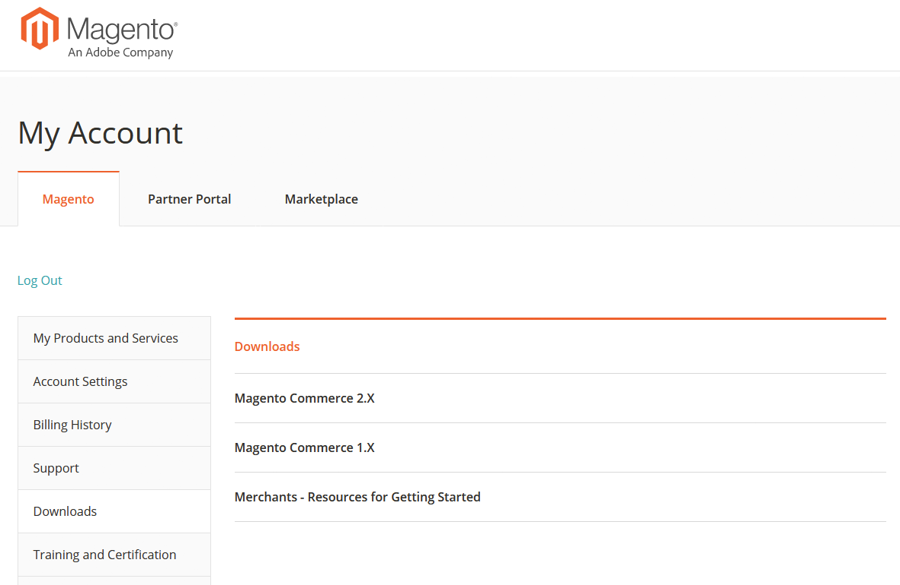

# Accedere alla Guida all’Assistenza clienti di Adobe Commerce

La Guida all’Assistenza clienti di Adobe Commerce spiega le offerte di assistenza clienti e come utilizzarle. Ciò include le best practice per la relazione di supporto, la raccolta delle informazioni necessarie per la diagnosi, la priorità dell’assistenza clienti, l’invio di una richiesta di supporto e i collegamenti alle risorse. Questa guida è accessibile dalla sezione download nella pagina del tuo account Magento. Per accedere a:

1. Vai alla pagina di accesso dell’account [&#x200B; di Magento.](https://account.magento.com/customer/account/login)
1. Accedi con il tuo nome utente e la tua password Magento.
1. Nella barra di navigazione a sinistra, fai clic su **Download**.
1. Nel riquadro di destra, fare clic su **Commercianti - Risorse per la Guida introduttiva**.  
