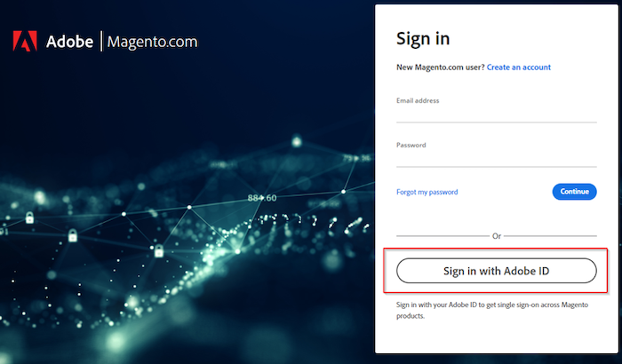

# Impossibile accedere al supporto Adobe Commerce o all’account cloud

Questo articolo fornisce una soluzione per i casi in cui hai difficoltà ad accedere al supporto Adobe Commerce o al progetto cloud.

## Prodotti e versioni interessati

Adobe Commerce (tutti i metodi di distribuzione) tutte le [versioni supportate](https://www.adobe.com/content/dam/cc/en/legal/terms/enterprise/pdfs/Adobe-Commerce-Software-Lifecycle-Policy.pdf)

## Problema

Quando accedi a [https://account.magento.com/customer/account/login/](https://account.magento.com/customer/account/login/) o [https://accounts.magento.cloud/user](https://accounts.magento.cloud/user) potresti notare che ora è disponibile un modulo di accesso unificato e che non puoi più immettere le credenziali come hai fatto in precedenza.

<u>Passaggi da riprodurre</u>:

Prova ad accedere al tuo account Commerce.

<u>Risultato previsto</u>:

Accesso riuscito.

<u>Risultato effettivo</u>:

Ricevi reindirizzato a una pagina per accedere con un account Adobe e le credenziali non funzionano.

## Causa

Come parte del processo di integrazione di Adobe Commerce con altre soluzioni Adobe, tutti gli utenti dovranno creare un accesso Adobe - se non ne hanno già uno - utilizzando lo stesso indirizzo e-mail connesso al proprio MageID.

## Soluzione

Puoi accedere all’account con:

- Un account aziendale/personale Adobe esistente.
- Se non hai un account Adobe, creane uno con lo stesso indirizzo e-mail.

Per i passaggi, consulta [Commerce Identity Manager](https://experienceleague.adobe.com/docs/commerce-admin/start/commerce-account/commerce-identity-manager.html) in Adobe Experience League.

## Lettura correlata

- [Collegamento Magento.com e accessi account accounts.magento.cloud](/help/faq/general/linking-magento-com-and-accounts-magento-cloud-account-logins.md)
